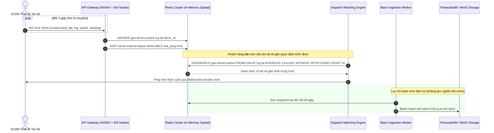

# 📋 Kế Hoạch Triển Khai: Realtime Geospatial Ingestion (3.300 writes/s) & High-Performance Driver Dispatch

`[DRAFT]` • **Issue liên kết:** #83 • **Phân loại:** `platform` • **Ngày khởi tạo:** 2026-10-26

---

## 1. 🎯 Tổng Quan & Bài Toán Cần Giải Quyết

### 1.1. Hiện trạng & Kịch bản Thảm họa (The Geospatial Ingestion Bottleneck)
- **Kịch bản**: Hệ thống mở rộng quy mô lên 10.000 tài xế hoạt động đồng thời trong giờ cao điểm.
  - Mỗi thiết bị tài xế gửi định vị GPS (vĩ độ, kinh độ, góc xoay, tốc độ) về server trung bình mỗi 3 giây một lần.
  - Tần suất ghi nhận: $\frac{10.000}{3} \approx \mathbf{3.333\text{ writes/giây}}$ liên tục không ngừng nghỉ.
- **Điểm gãy 1 - I/O Bottleneck & DB Bloat khi ghi trực tiếp PostgreSQL**:
  - Nếu mỗi tọa độ đều ghi một dòng vào bảng `t_driver_location` trong PostgreSQL: sau 1 ngày bảng sẽ có gần **300 triệu bản ghi**.
  - Việc đánh chỉ mục GiST (`PostGIS`) trên dữ liệu insert/update liên tục với tốc độ 3.300 writes/giây làm khóa bảng, nghẽn I/O đĩa cứng, kéo tụt hiệu năng của toàn bộ các bảng nghiệp vụ khác.
- **Điểm gãy 2 - Tính toán tìm tài xế gần nhất bị nghẽn (Matching Latency)**:
  - Khi có 500 đơn hàng mới cần ghép tài xế trong mỗi phút: Mỗi đơn hàng lại chạy câu truy vấn `ST_DWithin` quét bán kính 5km trên bảng dữ liệu đang bị lock liên tục. Kết quả: truy vấn mất 2 - 5 giây mới trả về, tài xế nhận cuốc muộn, thức ăn nguội, khách chờ đợi sốt ruột.

### 1.2. Mục tiêu kỹ thuật
1. **Decouple Realtime Ping khỏi Database Bền Vững (Zero Relational Writes for GPS Pings)**:
   - Toàn bộ ping GPS thời gian thực được ingest trực tiếp vào bộ nhớ RAM thông qua **Redis Geospatial Data Structure** (`GEOADD drivers:locations <lng> <lat> <driver_id>`) hoặc **Uber H3 Spatial Hexagonal Hierarchical Spatial Index** (độ phân giải resolution 8-9, diện tích mỗi ô lục giác ~0.7 km²).
   - Chỉ lưu vào TimescaleDB / Cold Storage bằng batch aggregation worker định kỳ (mỗi 1 phút gom cụm 1 lần) để phục vụ tra cứu lịch sử hành trình và khiếu nại.
2. **WebSocket Gateway with Backpressure & Protobuf/Binary Payload**:
   - Tối ưu Gateway Socket.IO / WS: Nén payload tọa độ xuống định dạng nhị phân nhẹ (giảm 70% băng thông mạng so với JSON thuần).
   - Áp dụng cơ chế Backpressure: Tự động điều chỉnh tần suất gửi của client dựa trên tình trạng mạng và vận tốc di chuyển (đứng yên gửi 10s/lần, di chuyển nhanh gửi 3s/lần).
3. **High-Speed Driver Dispatch Algorithm**:
   - Tìm kiếm $N$ tài xế gần nhất trong bán kính $R$ bằng lệnh nguyên tử Redis `GEORADIUS` / `GEOSEARCH` với thời gian thực thi $< 2\text{ms}$.
   - Kết hợp thuật toán Weighted Matching Score:
     $$\text{Score} = w_1 \times \text{Distance} + w_2 \times \text{AcceptanceRate} + w_3 \times \text{CurrentBatchLoad}$$

---

## 2. 🔍 Khảo Sát Hiện Trạng Codebase

| File / Component | Hiện trạng | Hành động cần thực hiện |
| :--- | :--- | :--- |
| [`backend/apps/delivery-service/src/modules/delivery/gateways`](file:///d:/code/FoodDelivery/backend/apps/delivery-service) | Gateway nhận socket đang broadcast JSON trực tiếp và lưu tọa độ vào memory local của single node. | Tích hợp Redis Adapter cho Socket.IO cluster, dùng `Redis Geo` phân tán. |
| [`backend/apps/delivery-service/src/modules/delivery/usecases`](file:///d:/code/FoodDelivery/backend/apps/delivery-service) | Thuật toán dispatch tìm tài xế chưa tối ưu hóa chỉ mục spatial in-memory. | Xây dựng `SpatialMatchingEngine` sử dụng Redis GEO và chấm điểm đa tiêu chí. |
| [`backend/libs/common/src`](file:///d:/code/FoodDelivery/backend/libs/common) | Chưa có module tính toán không gian địa lý dùng chung. | Xây dựng `GeoSpatialModule` cung cấp các hàm khoảng cách Haversine, H3 index mapper. |

---

## 3. 🛠️ Thiết Kế Chi Tiết & Luồng Dữ Liệu

### 3.1. Luồng Dữ Liệu Ingestion 3.300 writes/giây

---

## 4. 🧪 Kịch Bản Kiểm Thử 3 Nhánh (Testing Policy Compliance)

### 4.1. Nhánh 1: Happy Path (Dòng Chảy Chuẩn)
- **Kịch bản**: 100 tài xế gửi tọa độ đồng thời lên gateway. Một đơn hàng mới tại quán tọa độ $(X, Y)$ yêu cầu tìm 3 tài xế gần nhất trong bán kính 2km.
- **Kỳ vọng**: 
  - Redis GEO lưu trữ tọa độ chính xác.
  - Hàm `GEOSEARCH` trả về đúng 3 tài xế xếp theo thứ tự cự ly tăng dần với thời gian phản hồi $< 5\text{ms}$.

### 4.2. Nhánh 2: Edge Cases (Biên & Giới Hạn)
- **Kịch bản 1 (Tài xế mất kết nối đột ngột - Ghost Driver)**: Tài xế bị hết pin hoặc mất sóng, không gửi ping trong 30 giây.
- **Kỳ vọng**: Hệ thống có cơ chế Heartbeat TTL: Sau 30s không có ping, tài xế tự động bị loại khỏi danh sách điều phối active, tránh gửi đơn vào tài xế "ma".
- **Kịch bản 2 (Biên giới bán kính)**: Quán ở vị trí không có tài xế nào trong bán kính 3km.
- **Kỳ vọng**: Thuật toán tự động mở rộng bán kính theo cấp số nhân (Dynamic Radius Expansion: $3\text{km} \to 5\text{km} \to 7\text{km}$) sau mỗi 15 giây mà không bị crash.

### 4.3. Nhánh 3: Error & Rejection Flow (Ngoại Lệ & Khắc Phục)
- **Kịch bản**: Tọa độ GPS từ điện thoại bị nhiễu loạn hoặc giả mạo (Spoofing) gửi tọa độ không hợp lệ (vĩ độ $> 90$ hoặc nhảy cóc $500\text{km}$ trong 3 giây).
- **Kỳ vọng**: DTO Validation chặn đứng dữ liệu rác ngay tại Gateway, ghi log cảnh báo và ngắt kết nối tạm thời của client vi phạm.

---

## 5. ✅ Checklist Tiêu Chuẩn Cần Vượt Qua (Local CI Gate)

- [ ] **Linter**: `npm run lint` đạt 0 warnings, 0 errors.
- [ ] **Type Check**: `npx tsc --noEmit` đạt 0 errors.
- [ ] **Unit Tests (Vitest)**:
  - [ ] `libs/common/tests/geo-spatial-engine.spec.ts` pass 100%.
  - [ ] `delivery-service/tests/driver-location-ingestion.spec.ts` pass 100%.
  - [ ] `delivery-service/tests/driver-dispatch-matching.spec.ts` pass 100%.
- [ ] **Build Check**: `npm run build` thành công.
- [ ] **Traceability Header**: Đầy đủ `[Requirement/Issue]`, `[Branch: Happy|Edge|Error]`, `[Expected Output]`.
