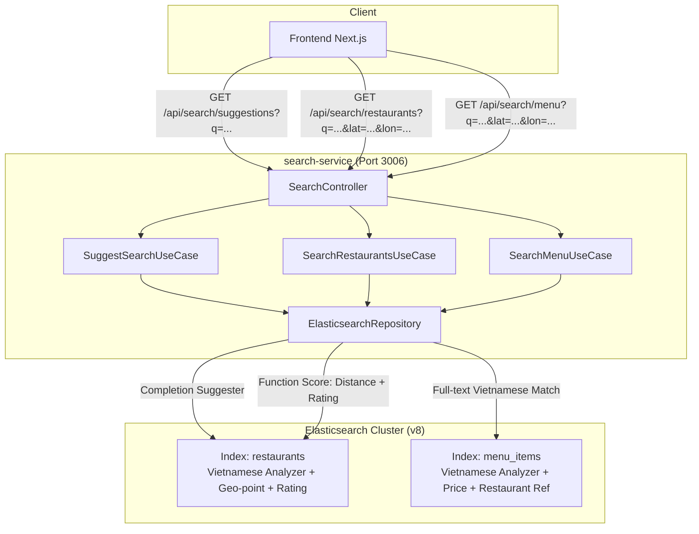
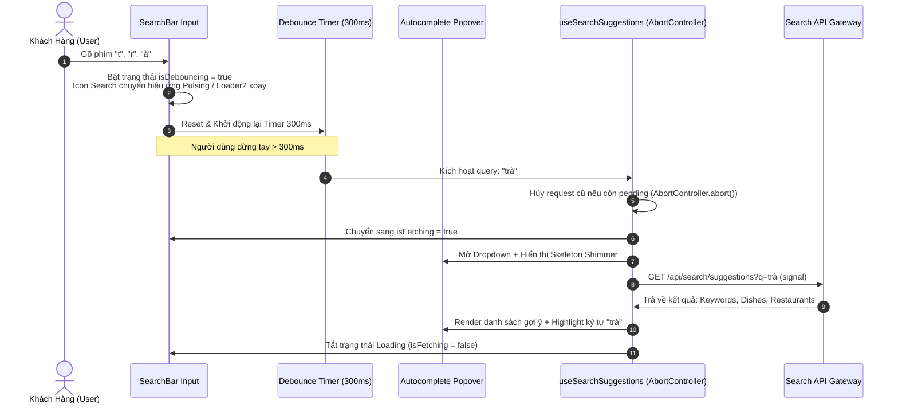
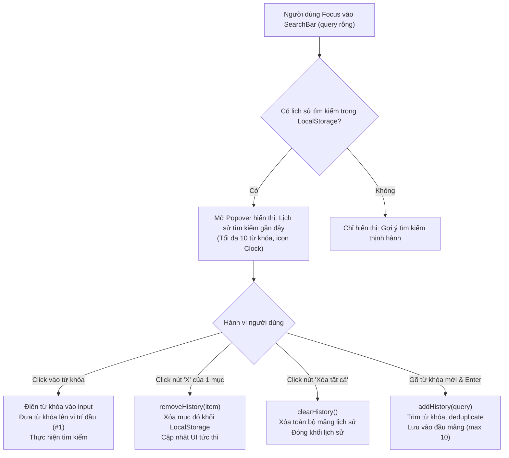

# 📋 Kế Hoạch Triển Khai: Smart Food Search Engine - Dual Indexing, Vietnamese Analysis & Multi-Factor Geo-Relevance Ranking

> **Mã công việc (Task Code):** `smart-food-search-engine`  
> **Trạng thái:** `[COMPLETED]`  
> **Tác giả:** `@orchestrator`  
> **Nhánh phát triển:** `feature/issue-87-smart-food-search-engine`  
> **GitHub Issue:** [#87](https://github.com/DuyBinh2003/FoodDelivery/issues/87)  
> **Tài liệu tham chiếu:** [`docs/services/search-service.md`](file:///d:/code/FoodDelivery/docs/services/search-service.md), [`docs/architecture/elasticsearch.md`](file:///d:/code/FoodDelivery/docs/architecture/elasticsearch.md), [`docs/plans/README.md`](file:///d:/code/FoodDelivery/docs/plans/README.md)

---

## 1. 🎯 Bối Cảnh & Mục Tiêu Nghiệp Vụ (Context & Objectives)

### 1.1. Hiện trạng & Điểm nghẽn tại Search Service
Hiện tại, [`search-service`](file:///d:/code/FoodDelivery/backend/apps/search-service/src/modules/search/repositories/elasticsearch.repository.ts) đang vận hành một phiên bản Elasticsearch cơ bản với các giới hạn nghiêm trọng:
1. **Thiếu Index Món ăn (Menu Items)**: Elasticsearch chỉ lưu thông tin nhà hàng (`restaurants`). Tìm kiếm món ăn (`/api/search/menu`) phải dùng cơ chế lai 2 bước: lấy danh sách `restaurant_id` từ Elasticsearch rồi gọi HTTP sang `restaurant-service` để query PostgreSQL. Nếu khách hàng tìm "Bún bò Huế" nhưng quán tên là "Quán Ăn Bà Ba", Elasticsearch hoàn toàn không tìm ra nhà hàng này.
2. **Analyzer Chuẩn không hỗ trợ Tiếng Việt**: Dùng `standard` analyzer mặc định, không hỗ trợ tìm kiếm không dấu ("bun bo" -> "bún bò"), không hỗ trợ chuẩn hóa Telex hay từ đồng nghĩa ẩm thực.
3. **Relevance Ranking Thô sơ**: Sắp xếp 100% dựa vào khoảng cách địa lý thẳng (`_geo_distance`). Một quán 1.0 sao cách 500m sẽ hiển thị trước một quán 4.9 sao nổi tiếng cách 600m.
4. **Thiếu Autocomplete / Search-as-you-type**: Chưa có endpoint gợi ý nhanh từ khóa hoặc món ăn/nhà hàng khi người dùng đang nhập trên thanh tìm kiếm.

### 1.2. Mục tiêu Nâng cấp Kỹ thuật
- **Dual-Index Model**: Xây dựng 2 index chuyên biệt `restaurants` và `menu_items` (hoặc mở rộng `restaurants` mapping lồng `menu_items`) để khách gõ tên món là ra ngay quán gần nhất có món đó.
- **Vietnamese Text Processing**: Tích hợp custom analyzer hỗ trợ `asciifolding`/`icu_folding` (tìm không dấu ra có dấu), `lowercase`, và `edge_ngram` cho tiền tố.
- **Multi-Factor Geo-Relevance Ranking**: Áp dụng `function_score` kết hợp:
  - Text relevance score (BM25).
  - Distance Decay (hàm suy giảm khoảng cách Gauss/Exponential).
  - Bayesian Rating weight (ưu tiên quán đánh giá cao, nhiều lượt review).
  - Trạng thái mở cửa (`is_active` / `is_open`).
- **Autocomplete Suggester API**: Endpoint `/api/search/suggestions?q=...` phản hồi dưới 30ms hỗ trợ Completion Suggester.

---

## 2. 🏗️ Kiến Trúc Hệ Thống & Sơ Đồ Luồng (Architecture & Flow)



---

## 3. 📝 Thiết Kế Chi Tiết & Mapping Elasticsearch

### 3.1. Index `restaurants` Mapping Mở Rộng
```json
{
  "settings": {
    "analysis": {
      "filter": {
        "vietnamese_stop": {
          "type": "stop",
          "stopwords": ["quán", "tiệm", "cửa hàng", "và", "ở"]
        },
        "edge_ngram_filter": {
          "type": "edge_ngram",
          "min_gram": 2,
          "max_gram": 20
        }
      },
      "analyzer": {
        "vi_analyzer": {
          "type": "custom",
          "tokenizer": "standard",
          "filter": ["lowercase", "asciifolding", "vietnamese_stop"]
        },
        "autocomplete_analyzer": {
          "type": "custom",
          "tokenizer": "standard",
          "filter": ["lowercase", "asciifolding", "edge_ngram_filter"]
        }
      }
    }
  },
  "mappings": {
    "properties": {
      "id": { "type": "keyword" },
      "name": {
        "type": "text",
        "analyzer": "vi_analyzer",
        "fields": {
          "autocomplete": { "type": "text", "analyzer": "autocomplete_analyzer" },
          "keyword": { "type": "keyword" }
        }
      },
      "location": { "type": "geo_point" },
      "rating": { "type": "float" },
      "total_reviews": { "type": "integer" },
      "is_active": { "type": "boolean" },
      "categories": { "type": "keyword" },
      "tags": { "type": "keyword" },
      "suggest": { "type": "completion" }
    }
  }
}
```

### 3.2. Index `menu_items` Mapping Mới
```json
{
  "mappings": {
    "properties": {
      "id": { "type": "keyword" },
      "restaurant_id": { "type": "keyword" },
      "restaurant_name": { "type": "text", "analyzer": "vi_analyzer" },
      "name": {
        "type": "text",
        "analyzer": "vi_analyzer",
        "fields": {
          "autocomplete": { "type": "text", "analyzer": "autocomplete_analyzer" }
        }
      },
      "description": { "type": "text", "analyzer": "vi_analyzer" },
      "price": { "type": "double" },
      "is_available": { "type": "boolean" },
      "tags": { "type": "keyword" },
      "location": { "type": "geo_point" },
      "rating": { "type": "float" }
    }
  }
}
```

### 3.3. Multi-Factor Relevance Scoring DSL (`function_score`)
Truy vấn nhà hàng kết hợp khoảng cách + rating:
```json
{
  "query": {
    "function_score": {
      "query": {
        "bool": {
          "must": [
            {
              "multi_match": {
                "query": "cơm tấm",
                "fields": ["name^3", "categories^2", "tags"],
                "fuzziness": "AUTO"
              }
            }
          ],
          "filter": [
            { "term": { "is_active": true } },
            {
              "geo_distance": {
                "distance": "10km",
                "location": { "lat": 10.762, "lon": 106.660 }
              }
            }
          ]
        }
      },
      "functions": [
        {
          "gauss": {
            "location": {
              "origin": { "lat": 10.762, "lon": 106.660 },
              "scale": "3km",
              "decay": 0.5
            }
          },
          "weight": 2.5
        },
        {
          "field_value_factor": {
            "field": "rating",
            "factor": 1.2,
            "modifier": "sqrt",
            "missing": 3.0
          },
          "weight": 1.5
        }
      ],
      "score_mode": "multiply",
      "boost_mode": "multiply"
    }
  }
}
```

### 3.4. Kiến Trúc Frontend: Lắng Nghe Hành Vi Tìm Kiếm & Phản Hồi Loading State Realtime

Để mang lại trải nghiệm mượt mà chuẩn Art Direction (Anti-Slop), giao diện tìm kiếm cần lắng nghe từng hành vi gõ phím của người dùng với cơ chế Loading 2 tầng và chặn Race Condition:



#### Chi tiết Kỹ thuật Triển khai trên Frontend:
1. **Quản lý Trạng thái 2 Tầng (Two-tier Loading State)**:
   - **Tầng 1 - `isDebouncing`**: Kích hoạt ngay lập tức khi `query !== debouncedQuery`. Góc phải ô input hiển thị spinner xoay nhẹ (`Loader2` từ `lucide-react`) để người dùng nhận biết hệ thống đang chờ kết thúc chuỗi gõ phím.
   - **Tầng 2 - `isFetching`**: Kích hoạt khi hết 300ms debounce và TanStack Query bắt đầu gửi request HTTP. Spinner tiếp tục xoay mượt mà cho đến khi dữ liệu trả về hoàn tất.
2. **Autocomplete Popover Dropdown**:
   - Tự động hiển thị bên dưới `SearchBar` khi `query.trim().length >= 2`.
   - Phân chia 3 khối rõ ràng:
     - 🔍 *Từ khóa thịnh hành & liên quan* (Trending Keywords).
     - 🍲 *Món ăn gợi ý* (kèm giá tiền và tên quán).
     - 🏪 *Nhà hàng phù hợp* (kèm rating sao và khoảng cách km).
   - Hỗ trợ điều hướng bằng bàn phím (`ArrowDown`, `ArrowUp`, `Enter`, `Escape`) và click-outside để đóng dropdown.
3. **Chống Race Condition & Hủy Request Lỗi thời (Request Cancellation)**:
   - Sử dụng `signal` từ TanStack Query (`AbortController`). Nếu người dùng tiếp tục gõ (ví dụ từ "trà" sang "trà sữa"), request cũ "trà" lập tức bị hủy ngầm, ngăn chặn tình trạng response cũ về sau ghi đè kết quả mới.

### 3.5. Quản Lý Lịch Sử Tìm Kiếm Người Dùng (Search History & Deletion Pipeline)

Nhằm tối ưu UX chuẩn ứng dụng đặt đồ ăn hàng đầu, hệ thống cung cấp tính năng lưu trữ và quản lý lịch sử tìm kiếm cục bộ (Client-side LocalStorage) với tốc độ phản hồi 0ms:



#### Chi tiết Kỹ thuật Triển khai:
1. **Lưu trữ Cục bộ (`localStorage`)**:
   - Sử dụng key: `food_delivery_search_history`.
   - Giới hạn tối đa **10 từ khóa** gần nhất (FIFO pruning).
   - Chuẩn hóa: tự động `trim()` khoảng trắng thừa.
   - **Deduplication**: Nếu từ khóa đã tồn tại trong lịch sử, di chuyển nó lên vị trí đầu tiên (`index = 0`) thay vì tạo mục trùng lặp.
2. **Giao diện Popover khi Focus**:
   - Khi người dùng click vào ô tìm kiếm mà chưa gõ ký tự (`query === ''`), dropdown tự động hiển thị khối:
     - Header: *"Lịch sử tìm kiếm"* kèm nút text *"Xóa tất cả"* (màu `zinc-400` hover `red-400`).
     - Danh sách từ khóa: Icon đồng hồ `History` / `Clock`, text từ khóa, và nút icon `X` nhỏ ở góc phải mỗi dòng.
3. **Thao tác Xoá Lịch Sử**:
   - **Xoá từng từ khóa (`removeHistory(keyword)`)**: Nhấn vào nút `X` của dòng tương ứng sẽ xóa ngay mục đó trong state và `localStorage`, sử dụng `e.stopPropagation()` để không vô tình kích hoạt tìm kiếm từ khóa đó.
   - **Xoá toàn bộ (`clearHistory()`)**: Nhấn vào *"Xóa tất cả"* sẽ xóa sạch mảng trong `localStorage` và chuyển popover về trạng thái rỗng hoặc chỉ hiển thị Trending.
4. **Hydration Safe & Resilience**:
   - Khởi tạo state bằng `useEffect` hoặc hàm helper an toàn để tránh lỗi **Hydration Mismatch** giữa Next.js SSR và trình duyệt.
   - Bọc toàn bộ thao tác đọc/ghi `localStorage` trong khối `try/catch` đề phòng người dùng bật chế độ ẩn danh chặn storage hoặc bộ nhớ vượt quota.

---

## 4. 📂 Danh Sách File Tác Động (Affected Files)

| File | Vai trò / Hành động |
| :--- | :--- |
| **Backend** | |
| [`backend/apps/search-service/src/modules/search/repositories/elasticsearch.repository.ts`](file:///d:/code/FoodDelivery/backend/apps/search-service/src/modules/search/repositories/elasticsearch.repository.ts) | Cập nhật mapping `restaurants`, thêm index `menu_items`, triển khai `function_score` query & completion suggester. |
| [`backend/apps/search-service/src/modules/search/usecases/search-restaurants.usecase.ts`](file:///d:/code/FoodDelivery/backend/apps/search-service/src/modules/search/usecases/search-restaurants.usecase.ts) | Nhận các tham số mới (`sort_by`, `open_only`), chuyển tiếp `function_score`. |
| [`backend/apps/search-service/src/modules/search/usecases/search-menu.usecase.ts`](file:///d:/code/FoodDelivery/backend/apps/search-service/src/modules/search/usecases/search-menu.usecase.ts) | Chuyển đổi từ query PostgreSQL 2-step sang trực tiếp index `menu_items` của Elasticsearch. |
| [`backend/apps/search-service/src/modules/search/usecases/suggest-search.usecase.ts`](file:///d:/code/FoodDelivery/backend/apps/search-service/src/modules/search/usecases) | **Tạo mới**: Xử lý logic gợi ý từ khóa/món ăn theo thời gian thực. |
| [`backend/apps/search-service/src/modules/search/search.controller.ts`](file:///d:/code/FoodDelivery/backend/apps/search-service/src/modules/search/search.controller.ts) | Thêm endpoint `GET /search/suggestions` và mở rộng query params. |
| [`backend/apps/search-service/src/modules/search/tests/smart-search.spec.ts`](file:///d:/code/FoodDelivery/backend/apps/search-service/src/modules/search) | **Tạo mới**: Bộ Unit test 3 nhánh kiểm thử tính chính xác của Search DSL, Suggester và Ranking. |
| **Frontend** | |
| [`frontend/src/features/search/components/SearchBar.tsx`](file:///d:/code/FoodDelivery/frontend/src/features/search/components/SearchBar.tsx) | Nâng cấp thanh tìm kiếm: Loading spinner 2 tầng (`isDebouncing` + `isFetching`), Clear button, Autocomplete Dropdown Popover, Render khối Lịch sử tìm kiếm với nút xóa từng mục và xóa tất cả. |
| [`frontend/src/features/search/hooks/use-search-history.ts`](file:///d:/code/FoodDelivery/frontend/src/features/search/hooks) | **Tạo mới**: Custom hook quản lý lịch sử tìm kiếm trong `localStorage` (`history`, `addHistory`, `removeHistory`, `clearHistory`, hydration safe). |
| [`frontend/src/features/search/hooks/use-search.ts`](file:///d:/code/FoodDelivery/frontend/src/features/search/hooks/use-search.ts) | Bổ sung hook `useSearchSuggestions(query)` với AbortController và debounce pipeline. |
| [`frontend/src/features/search/api/search-api.ts`](file:///d:/code/FoodDelivery/frontend/src/features/search/api/search-api.ts) | Thêm hàm `getSearchSuggestions(query, signal)`. |
| [`frontend/src/features/search/types/index.ts`](file:///d:/code/FoodDelivery/frontend/src/features/search/types) | Bổ sung types: `SearchSuggestionResult`, `DishSuggestion`, `RestaurantSuggestion`. |
| [`frontend/src/features/search/tests/search-bar-loading.test.ts`](file:///d:/code/FoodDelivery/frontend/src/features/search/tests) | **Tạo mới**: Unit test kiểm thử hành vi gõ phím, loading state và debounce pipeline. |
| [`frontend/src/features/search/tests/search-history.test.ts`](file:///d:/code/FoodDelivery/frontend/src/features/search/tests) | **Tạo mới**: Unit test kiểm thử lưu lịch sử, deduplicate, xóa từng mục và xóa toàn bộ. |

---

## 5. 🧪 Kịch Bản Kiểm Thử 3 Nhánh (3-Branch Testing Scenarios)

### Nhánh 1: Happy Path (HP)
- **HP-01 (Backend)**: Tìm kiếm không dấu ("com tam") trả về chính xác nhà hàng có tên có dấu ("Cơm Tấm Sài Gòn").
- **HP-02 (Backend)**: Tìm kiếm tên món ("Trà sữa ô long") trả về danh sách món ăn từ index `menu_items` kèm thông tin nhà hàng và khoảng cách hợp lệ.
- **HP-03 (Backend)**: Gợi ý nhanh Autocomplete khi gõ `tra s` trả về cụm từ đề xuất `["trà sữa", "trà sen", "trà sâm dứa"]`.
- **HP-04 (Backend)**: Xếp hạng Relevance Score: Quán 4.9 sao cách 1.5km có điểm số tổng hợp cao hơn quán 2.0 sao cách 1.2km khi cùng khớp từ khóa tìm kiếm.
- **HP-05 (Frontend UI)**: Khi người dùng gõ ký tự vào ô tìm kiếm, icon loading hiển thị ngay lập tức; sau 300ms dừng tay, dropdown gợi ý hiển thị và spinner ẩn đi khi tải xong.
- **HP-06 (Frontend UI)**: Nhấn phím `ArrowDown` chọn món ăn trong dropdown và bấm `Enter` điều hướng chính xác đến trang món ăn hoặc cập nhật query vào URL.
- **HP-07 (Frontend History)**: Thực hiện tìm kiếm "Cơm sườn", từ khóa được lưu vào `localStorage`. Focus lại vào ô tìm kiếm rỗng, "Cơm sườn" hiển thị ở đầu danh sách lịch sử.
- **HP-08 (Frontend History)**: Bấm nút `X` của 1 mục lịch sử -> mục đó lập tức biến mất khỏi danh sách. Bấm "Xóa tất cả" -> toàn bộ danh sách lịch sử bị dọn sạch.

### Nhánh 2: Edge Cases (EC)
- **EC-01 (Backend)**: Tọa độ người dùng nằm ở biên bán kính giao hàng (đúng 9.99km trên bán kính 10km) vẫn được include vào kết quả.
- **EC-02 (Backend)**: Từ khóa tìm kiếm chứa các ký tự đặc biệt (`%`, `*`, `\`, dấu ngoặc kép, khoảng trắng thừa) không làm lỗi cú pháp Query DSL của Elasticsearch.
- **EC-03 (Backend)**: Quán ăn chưa có đánh giá nào (`rating = null` hoặc `0`), hệ thống gán giá trị mặc định (`missing: 3.0`) mà không văng lỗi NaN.
- **EC-04 (Frontend UI)**: Người dùng gõ phím liên tục với tốc độ cao (fast typing) -> Chỉ duy nhất 1 request của cụm từ cuối cùng được hoàn tất, các request trung gian bị abort tự động, không gây giật lag UI.
- **EC-05 (Frontend UI)**: Click chuột ra ngoài khu vực thanh tìm kiếm (click-outside) -> Dropdown gợi ý tự động đóng lại mà không làm mất nội dung đang gõ.
- **EC-06 (Frontend History)**: Tìm kiếm lại một từ đã có trong lịch sử -> Không nhân đôi bản ghi mà đưa từ đó lên vị trí số 1 (deduplicate).
- **EC-07 (Frontend History)**: Lưu vượt quá 10 từ khóa -> Hệ thống tự động cắt bỏ từ khóa cũ nhất để duy trì tối đa 10 mục.

### Nhánh 3: Error & Rejection Flow (ER)
- **ER-01 (Backend)**: Gọi tìm kiếm với tham số tọa độ không hợp lệ (`lat > 90` hoặc `lon > 180`) -> `400 Bad Request`.
- **ER-02 (Backend)**: Elasticsearch Service tạm thời ngắt kết nối -> Ném `ServiceUnavailableException` có root cause đầy đủ, không swallow lỗi âm thầm.
- **ER-03 (Backend)**: Tìm kiếm từ khóa vô nghĩa dài bất thường (> 100 ký tự) -> Validate chặn từ DTO, không gửi truy vấn tốn kém tới cụm Elasticsearch.
- **ER-04 (Frontend UI)**: API Suggestions gặp lỗi mạng hoặc 500 -> Loading spinner tự động tắt sau timeout, dropdown ẩn nhẹ nhàng không crash màn hình, giao diện tìm kiếm chính vẫn hoạt động bình thường.
- **ER-05 (Frontend History)**: Trình duyệt tắt quyền `localStorage` (Private Browsing / Quota Exceeded) -> Thao tác đọc/ghi lịch sử bắt lỗi an toàn qua `try/catch`, ứng dụng tiếp tục hoạt động mà không gây crash màn hình.


---

## 6. 🔒 Cổng Kiểm Soát CI Nội Bộ (Local CI Gate)
Trước khi bàn giao sang Reviewer, giải pháp bắt buộc vượt qua:
1. `npm run lint` trên cả backend và frontend: **0 errors, 0 warnings**.
2. `npx tsc --noEmit` trên cả backend và frontend: **0 error**.
3. `npm test` trên search-service và frontend: **100% pass** trên toàn bộ test cases 3 nhánh.
4. `npm run build` trên cả backend và frontend: **Biên dịch thành công**.

