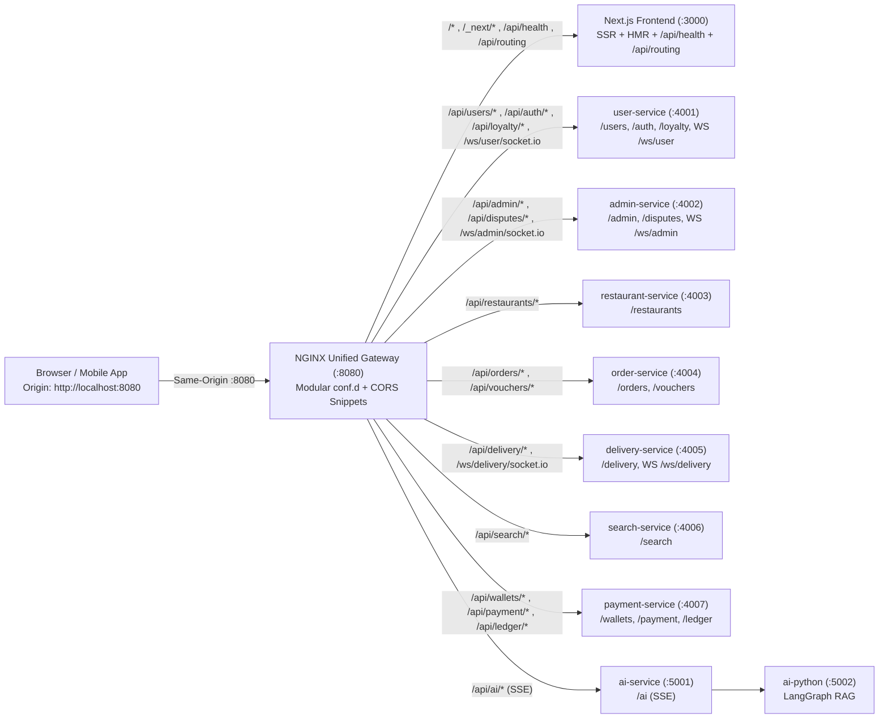

> **Trạng thái:** `[COMPLETED]`  
> **Phân loại:** `platform` | **Truy vết:** Sinh từ phiên `/grill-me` ngày 2026-11-25  
> **Mục tiêu:** Quy hoạch lại toàn bộ dải Port theo tầng, thiết kế kiến trúc NGINX Unified Reverse Proxy (cổng `:8080`) chuẩn Modular để dễ mở rộng service mới, xử lý triệt để lỗi CORS/Cross-Origin cho cả REST, SSE và 3 luồng WebSocket, đồng bộ hoàn chỉnh Hybrid Dev & Docker Full-Stack.

---

## 1. Tóm tắt Quyết định Thiết kế (Resolved Design Decisions)

| Hạng mục | Quyết định đã thống nhất |
|---|---|
| **Entry Point & Topology** | **Unified Reverse Proxy qua NGINX (`:8080`)** — bọc cả Frontend (`:3000`) lẫn toàn bộ Microservices (REST + SSE + WebSocket) về cùng 1 Origin (`http://localhost:8080`) để triệt tiêu CORS. |
| **Port Band Convention** | Gateway `:8080` \| Frontend `:3000` \| Core NestJS Services `:4001–4099` \| AI/Python Services `:5001–5099` \| Infra `:5432/:6379/:9200/:4566`. |
| **URL Prefix Routing** | REST đi qua `/api/<resource>/*` (NGINX strip `/api/` khi proxy vào NestJS; ngoại lệ `/api/routing`, `/api/health` đi vào Next.js) \| Page & `/_next/*` đi vào Next.js `:3000`. |
| **WebSocket Routing** | Tách path Socket.IO riêng từng service: `/ws/user/socket.io`, `/ws/admin/socket.io`, `/ws/delivery/socket.io` + hỗ trợ Next.js HMR `/_next/webpack-hmr` qua NGINX. |
| **NGINX Modular & CORS** | Tách `snippets/` + `routes.conf` dùng chung + tách riêng `upstreams.docker.conf` vs `upstreams.local.conf`; CORS allowlist tập trung đọc từ `CORS_ALLOWED_ORIGINS` (dự phòng khi dev mở `:3000` trực tiếp hoặc LAN/domain). |
| **Dynamic Port Env** | Mọi microservice đọc port qua `<SERVICE>_PORT` / `PORT` (dùng helper chung `backend/libs/common`) — hỗ trợ chạy chung 1 file `backend/.env` hoặc tách container độc lập. |
| **Môi trường vận hành** | Đồng bộ cả **Hybrid Dev** (`docker-compose.local-gateway.yml` + `npm run start:all` + `npm run dev` có HMR qua `:8080`) và **Docker Full-Stack** (thêm `frontend` + `api-gateway` `:8080` vào `docker-compose.yml`). |

---

## 2. Quy hoạch Dải Port (Port Band Allocation Table)

| Nhóm / Dải Port | Service | Port mới | Env Var điều khiển Port | Ghi chú |
|---|---|---:|---|---|
| **Public Gateway** | `api-gateway` (NGINX) | **`8080`** | `GATEWAY_PORT=8080` | Cổng duy nhất mở cho Browser / Mobile |
| **Frontend App** | `frontend` (Next.js 16) | **`3000`** | `PORT=3000` | Đứng sau NGINX `:8080` |
| **Core Services (`4001–4099`)** | `user-service` | **`4001`** | `USER_SERVICE_PORT` / `PORT` | Auth, Users, Loyalty, WS `/ws/user/socket.io` |
| | `admin-service` | **`4002`** | `ADMIN_SERVICE_PORT` / `PORT` | Admin, Disputes, WS `/ws/admin/socket.io` |
| | `restaurant-service` | **`4003`** | `RESTAURANT_SERVICE_PORT` / `PORT` | Restaurants, Menu, Operating Hours |
| | `order-service` | **`4004`** | `ORDER_SERVICE_PORT` / `PORT` | Orders, Vouchers, Reviews |
| | `delivery-service` | **`4005`** | `DELIVERY_SERVICE_PORT` / `PORT` | Dispatch, Tracking, WS `/ws/delivery/socket.io` |
| | `search-service` | **`4006`** | `SEARCH_SERVICE_PORT` / `PORT` | Search Catalog, Elastic, Circuit Breaker |
| | `payment-service` | **`4007`** | `PAYMENT_SERVICE_PORT` / `PORT` | Ledger, Wallets, Withdrawals, Webhooks |
| | *(Slot mở rộng)* | `4008–4099` | `<NAME>_SERVICE_PORT` | Dành cho Notification, Analytics, Promotion v2... |
| **AI / Python (`5001–5099`)** | `ai-service` (NestJS) | **`5001`** | `AI_SERVICE_PORT` / `PORT` | Chatbox Orchestrator & SSE |
| | `ai-python` (FastAPI) | **`5002`** | `AI_PYTHON_PORT=5002` | LangGraph CRAG Core (container port `5002` / `8000` mapped) |
| **Infrastructure** | PostgreSQL / pgvector | `5432` | `POSTGRES_PORT` | Nội bộ / Docker |
| | Redis | `6379` | `REDIS_PORT` | Nội bộ / Docker |
| | Elasticsearch | `9200` | `ELASTICSEARCH_NODE` | Nội bộ / Docker |
| | LocalStack (S3/SQS/SNS) | `4566` | `LOCALSTACK_ENDPOINT` | Nội bộ / Docker |

---

## 3. Sơ đồ Kiến trúc & Định tuyến (Unified Reverse Proxy)



---

## 4. Thiết kế Chi tiết Từng Lớp (Modular Architecture)

### 4.1 Lớp NGINX Gateway (`gateway/`)
Tổ chức cấu trúc Modular để **thêm service mới không phải nhân bản code** và dùng chung cho cả Docker Full-Stack lẫn Hybrid Dev:

```text
gateway/
├── nginx.docker.conf              # Entrypoint mount cho docker-compose.yml
├── nginx.local.conf               # Entrypoint mount cho docker-compose.local-gateway.yml
├── snippets/
│   ├── proxy-common.conf          # Host, X-Real-IP, X-Forwarded-*, X-Trace-Id, timeouts
│   ├── ws-common.conf             # HTTP/1.1 Upgrade, Connection, 86400s read/send timeout
│   └── cors-headers.conf          # Single-layer CORS headers (always) + OPTIONS 204 preflight
└── conf.d/
    ├── shared-http.conf           # Rate limit zones, Connection/Trace maps, CORS origin allowlist map
    ├── upstreams.docker.conf      # Upstream DNS Docker (frontend:3000, user-service:4001, ...)
    ├── upstreams.local.conf       # Upstream host.docker.internal (3000, 4001..5001)
    └── routes.conf                # Single Source of Truth cho toàn bộ location blocks (/, /api/*, /ws/*)
```

> **Quy tắc định tuyến tại `gateway/conf.d/routes.conf`:**
> 1. **Chặn Internal APIs:** `~ ^/(api/)?.*/internal/` và `~ ^/(api/)?internal/` → `403`.
> 2. **Next.js Reserved API routes:** `location = /api/health` và `location = /api/routing` → `proxy_pass http://frontend_app;` (không đẩy sang Backend).
> 3. **Backend REST routes (strip `/api/`):**
>    - `/api/users/`, `/api/auth/`, `/api/loyalty/` → `user_service`
>    - `/api/admin/`, `/api/disputes/` → `admin_service`
>    - `/api/restaurants/` → `restaurant_service`
>    - `/api/orders/`, `/api/vouchers/` → `order_service`
>    - `/api/delivery/` → `delivery_service`
>    - `/api/search/` → `search_service`
>    - `/api/wallets/`, `/api/payment/`, `/api/ledger/` → `payment_service`
>    - `/api/ai/` → `ai_service` (tắt `proxy_buffering`, giữ chunked SSE)
> 4. **WebSocket Gateway routes:**
>    - `location /ws/user/socket.io` → `http://user_service`
>    - `location /ws/admin/socket.io` → `http://admin_service`
>    - `location /ws/delivery/socket.io` → `http://delivery_service` (với `ip_hash`)
> 5. **Frontend Catch-All & Next.js HMR:**
>    - `location /_next/webpack-hmr` → `http://frontend_app` kèm `ws-common.conf` (HMR chạy mượt qua `:8080`).
>    - `location /` → `http://frontend_app` (Next.js App Router).

### 4.2 Lớp Backend (`backend/`)
1. **Shared Bootstrap & CORS Helper (`backend/libs/common/src/bootstrap/service-bootstrap.ts`):**
   - `resolveServicePort(serviceEnvKey: string, defaultPort: number): number` — đọc theo thứ tự `process.env[serviceEnvKey]` → `process.env.PORT` → `defaultPort` (kiểm tra hợp lệ `1..65535`, throw lỗi rõ ràng nếu giá trị env sai định dạng).
   - `parseAllowedCorsOrigins(raw?: string): string[]` — parse `CORS_ALLOWED_ORIGINS` (ngăn cách dấu phẩy), tự nhận diện local/LAN dev patterns (`localhost`, `127.0.0.1`, `[::1]`) khi `NODE_ENV !== 'production'`.
   - `configureAppCors(app: INestApplication): void` — bật CORS chuẩn với `origin` validator function, `credentials: true`, `methods`, và `allowedHeaders` (`Authorization`, `Content-Type`, `Accept`, `X-Trace-Id`, `Idempotency-Key`, `Cache-Control`).
   - Export từ `@/common/bootstrap/index.js` và áp dụng cho toàn bộ 8 file `apps/*/src/main.ts`.
2. **WebSocket Gateways Path Standardization:**
   - `user-service` (`UserGateway`): `{ namespace: 'user', path: '/ws/user/socket.io', cors: getWsCorsOptions() }`
   - `admin-service` (`AdminGateway`): `{ namespace: 'admin', path: '/ws/admin/socket.io', cors: getWsCorsOptions() }`
   - `delivery-service` (`TrackingGateway`): `{ namespace: 'delivery', path: '/ws/delivery/socket.io', cors: getWsCorsOptions() }`
3. **Đồng bộ Inter-Service URLs & Healthcheck:**
   - Cập nhật `backend/.env`, `backend/libs/config/src/configuration.ts` (đọc thêm các port env và `PUBLIC_GATEWAY_URL`).
   - Cập nhật `payment-gateway.service.ts` dùng `PUBLIC_GATEWAY_URL` (`http://localhost:8080/api/payment/webhooks/...`).
   - Xác minh mọi service đều có `@Get('health')` / health route cho Docker `HEALTHCHECK` (`backend/Dockerfile` giữ `process.env.PORT || 4001`).

### 4.3 Lớp Frontend (`frontend/`)
1. **Same-Origin Gateway Configuration:**
   - `frontend/package.json`: `"dev": "next dev -p 3000"`, `"start": "next start -p 3000"`.
   - `frontend/.env.local` & `frontend/.env.example`:
     - `NEXT_PUBLIC_API_GATEWAY_URL=/api` (Browser gọi relative Same-Origin `/api/...` qua NGINX `:8080` — 0 CORS; hoặc `http://localhost:8080/api` khi muốn explicit URL).
     - `NEXT_PUBLIC_INTERNAL_API_GATEWAY_URL=http://api-gateway:8080/api` (hoặc `NEXT_PUBLIC_*_SERVICE_URL=http://localhost:400x` dùng cho SSR Node.js khi gọi nội bộ!).
     - WebSocket: `NEXT_PUBLIC_USER_WS_URL=/user` + `NEXT_PUBLIC_USER_WS_PATH=/ws/user/socket.io` (tương tự `ADMIN`, `DELIVERY`) — tự kết nối Same-Origin qua NGINX `:8080` (vẫn hỗ trợ truyền full URL `http://localhost:8080/user` hoặc direct `http://localhost:4001/user`).
2. **Cập nhật Resolver (`src/lib/api-url.ts`) & Socket Providers:**
   - `resolveServiceUrl(endpoint)` hỗ trợ `gatewayUrl = '/api'` (relative Same-Origin) trên Browser (`typeof window !== 'undefined'`), còn trên Server (SSR RSC) resolve về `NEXT_PUBLIC_INTERNAL_API_GATEWAY_URL` hoặc per-service URL (`4001..5001`) để Next.js Server gọi Backend không bao giờ bị relative URL error (`Invalid URL`)!
   - Thêm `/api/health/route.ts` trả HTTP `200 { status: 'ok' }` phục vụ Docker `HEALTHCHECK` trong `frontend/Dockerfile`.
   - Cập nhật `frontend/Dockerfile` bổ sung đầy đủ `ARG`/`ENV` mới và `frontend/next.config.ts` rewrites trỏ tới dải port `4001..5001`.

### 4.4 Lớp Hạ tầng Docker, VS Code & CI/CD
- `docker-compose.yml`: cập nhật toàn bộ ports `4001..4007`, `5001..5002`, thêm service **`frontend`** (`:3000` nội bộ, exposed cho debug nếu cần hoặc qua gateway), cập nhật **`api-gateway`** lên cổng **`8080:8080`** mount `gateway/nginx.docker.conf` + `snippets/` + `conf.d/`.
- `docker-compose.local-gateway.yml`: mount `gateway/nginx.local.conf` + `snippets/` + `conf.d/` ở cổng **`8080:8080`** cho Hybrid Dev.
- `.vscode/tasks.json`: đồng bộ `Dev: Gateway Up` dùng cổng `:8080` và hướng dẫn mở trình duyệt tại `http://localhost:8080`.
- `.github/workflows/ci-frontend.yml`: đồng bộ env CI build (`4001..5001`, `/api`).
- Cập nhật tài liệu chính thức: `docs/architecture/system-architecture.md`, `docs/architecture/frontend-backend-connection.md`, `docs/frontend/frontend-ui.md`, và thêm hướng dẫn **"Quy trình mở rộng Microservice mới (3 bước)"**.

---

## 5. Kịch bản Kiểm thử 3 Nhánh (Testing Plan)

### 5.1 Backend Unit Tests (`backend/libs/common/src/bootstrap/tests/service-bootstrap.spec.ts` - Vitest)
- **🟢 Happy Path:**
  - `resolveServicePort('ORDER_SERVICE_PORT', 4004)` ưu tiên `ORDER_SERVICE_PORT`, tiếp đến `PORT`, cuối cùng là `defaultPort`.
  - `parseAllowedCorsOrigins` phân giải chuẩn danh sách domain phân cách bằng dấu phẩy và cắt khoảng trắng.
  - `createCorsOriginValidator` cho phép origin nằm trong allowlist hoặc `localhost:*` / `127.0.0.1:*` ở môi trường dev và từ chối origin lạ khi cấu hình strict.
- **🟡 Edge Cases:**
  - Request không có `Origin` header (curl/server-to-server/mobile native) được phép đi qua (`callback(null, true)`).
  - Xử lý URL có dấu `/` ở cuối hoặc chữ hoa/thường trong `CORS_ALLOWED_ORIGINS`.
- **🔴 Error & Rejection Flow:**
  - `resolveServicePort` ném lỗi rõ ràng khi port env là chuỗi không hợp lệ (`abc`, `-1`, `70000`).
  - `createCorsOriginValidator` chặn origin không hợp lệ ở production (`NODE_ENV=production`) và trả về `false` (không crash server).

### 5.2 Frontend Unit Tests (`frontend/src/lib/tests/api-gateway-routing.test.ts` - `node --test`)
- **🟢 Happy Path:**
  - Browser (`typeof window !== 'undefined'` / `windowOrigin` giả lập) với `NEXT_PUBLIC_API_GATEWAY_URL=/api` + endpoint `/orders/history/me` → resolve thành `baseUrl: 'http://localhost:8080'`, `path: '/api/orders/history/me'` (Same-Origin!).
  - SSR Server (`window` không tồn tại) với `NEXT_PUBLIC_API_GATEWAY_URL=/api` + `NEXT_PUBLIC_INTERNAL_API_GATEWAY_URL=http://api-gateway:8080/api` → resolve thành URL tuyệt đối hợp lệ để `fetch()` SSR không lỗi.
  - Socket helper `resolveSocketConnectionConfig` tách chuẩn URL + `path` (`/ws/user/socket.io`, `/ws/admin/socket.io`, `/ws/delivery/socket.io`).
- **🟡 Edge Cases:**
  - Endpoint đã có tiền tố `/api/vouchers/...` không bị nhân đôi thành `/api/api/vouchers/...`.
  - Reserved Next.js route `/api/routing` hoặc `/api/health` giữ nguyên Same-Origin.
- **🔴 Error & Rejection Flow:**
  - SSR không có cả `INTERNAL_API_GATEWAY_URL` lẫn `NEXT_PUBLIC_*_SERVICE_URL` → throw `[ConfigError]` fail-fast.
  - Endpoint rỗng hoặc khoảng trắng → throw error mô tả rõ ràng.

### 5.3 NGINX Syntax Validation & Local CI Gate
- Validate đồng thời cả 2 entrypoint qua NGINX container thật:
  - `docker run --rm ... nginx -t` cho `gateway/nginx.docker.conf` (tất cả upstream container names + `frontend:3000`)
  - `docker run --rm ... nginx -t` cho `gateway/nginx.local.conf` (`host.docker.internal`)
- **Frontend CI Gate:** `npm run lint` (0 errors/warnings), `npx tsc --noEmit` (0 errors), `npm test` (100% pass), `npm run build` (pass).
- **Backend CI Gate:** `npm run lint` (oxlint 0 warnings/errors), `npx tsc --noEmit` (0 errors), `npm run test` (100% pass), `npm run build` (nest build 100% pass).

---

## 6. Checklist Triển khai (Implementation Checklist)

- [x] **Phase 1:** Tạo NGINX Modular (`gateway/snippets/*`, `gateway/conf.d/*`, `gateway/nginx.conf`, `gateway/nginx.local.conf`) & kiểm tra `nginx -t` (pass cả 2 file).
- [x] **Phase 2:** Tạo `backend/libs/common/src/bootstrap/service-bootstrap.ts` + unit tests 3 nhánh + cập nhật 8 `main.ts`, 3 WebSocket Gateways, `payment-gateway.service.ts`, `ai-python/main.py`, `backend/Dockerfile`, `backend/.env`.
- [x] **Phase 3:** Cập nhật Frontend (`src/app/api/health/route.ts`, `api-url.ts`, `ws-config.ts`, 4 Socket consumers, `package.json`, `.env.local`, `.env.example`, `next.config.ts`, `Dockerfile`) + unit tests 3 nhánh.
- [x] **Phase 4:** Cập nhật `docker-compose.yml`, `docker-compose.local-gateway.yml`, `.env`, `.env.example`, `.vscode/tasks.json`, `.github/workflows/ci-frontend.yml`.
- [x] **Phase 5:** Chạy trọn bộ CI Gate (`backend`: oxlint 0 errors/warnings, 45/45 suites / 360 tests pass, 8/8 `nest build` OK; `frontend`: 209/209 tests pass, eslint 0 errors/warnings, `tsc --noEmit` 0 errors, `next build` 30/30 routes OK) & cập nhật tài liệu chính thức trong `docs/`.
