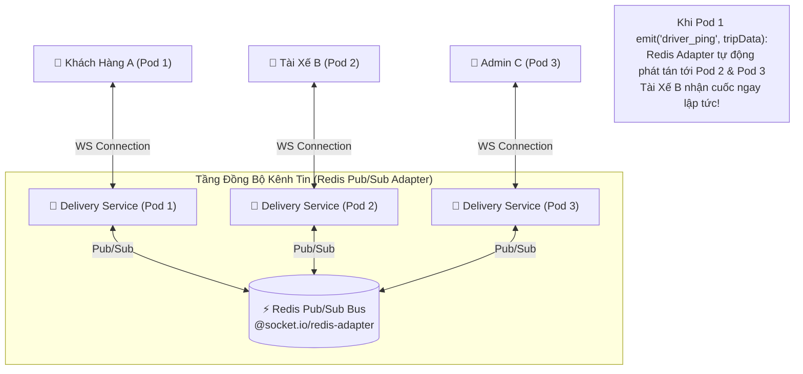

# 📋 Kế Hoạch Triển Khai: Mở Rộng Cụm WebSocket Đa Máy Chủ & Giám Sát Phân Tán (WebSocket Redis Adapter & Distributed APM)

`[DRAFT]` • **Issue liên kết:** #89 • **Phân loại:** `platform` • **Ngày khởi tạo:** 2026-11-09

---

## 1. 🎯 Tổng Quan & Bài Toán Cần Giải Quyết

### 1.1. Hiện trạng & Giới Hạn Đơn Node (The Single-Node WebSocket Trap)
- **Hiện trạng:**
  - `delivery-service` và Gateway sử dụng Socket.IO chạy trên một container độc lập với bộ nhớ RAM cục bộ.
- **Rủi ro khi đưa lên môi trường chịu tải cao (Clustered Environment):**
  - Khi triển khai hệ thống lên nhiều replicas (ví dụ: Kubernetes Pod 1, Pod 2, Pod 3 sau Load Balancer):
  - Khách hàng kết nối vào Pod 1, nhưng Tài xế lại kết nối vào Pod 2.
  - Khi Pod 1 phát sự kiện `ORDER_DISPATCH`, Pod 1 chỉ broadcast cho các client đang kết nối trực tiếp với nó; **Tài xế ở Pod 2 hoàn toàn không nhận được thông báo**, dẫn tới đơn bị bỏ lỡ.
  - Ngoài ra, hệ thống chưa có **Distributed Tracing (Truy vết phân tán)**: Khi một đơn hàng bị chậm hoặc lỗi 500, kỹ sư không thể biết độ trễ nằm ở chặng Gateway, Order, Payment hay Delivery.

### 1.2. Mục tiêu kỹ thuật
1. **Mở Rộng WebSocket Đa Node Với Redis Adapter (`@socket.io/redis-adapter`)**:
   - Sử dụng Redis Pub/Sub làm message bus kết nối giữa tất cả các WebSocket pods.
   - Bất kỳ event broadcast hoặc room emit nào được kích hoạt ở một pod sẽ tự động được đồng bộ xuyên suốt toàn bộ các pods khác với độ trễ $< 2\text{ms}$.
2. **Hỗ Trợ Sticky Sessions & NGINX Polling Fallback**:
   - Cấu hình NGINX Gateway hỗ trợ Header `Upgrade` và thuật toán băm IP (`ip_hash`) đảm bảo kết nối WebSocket và HTTP Long Polling không bị rớt khi chuyển đổi pod.
3. **Giám Sát Phân Tán (Distributed Tracing & APM)**:
   - Tích hợp **OpenTelemetry SDK** cấp phát `traceId` và `spanId` xuyên suốt từ Gateway qua 7 microservices.
   - Xuất dữ liệu metric sang Prometheus (HTTP RPS, Error Rates, Queue Depth) và trực quan hóa dashboard giám sát trên Grafana.

---

## 2. 🔍 Khảo Sát Hiện Trạng Codebase

| File / Component | Hiện trạng | Hành động cần thực hiện |
| :--- | :--- | :--- |
| [`backend/libs/common/src/adapters`](file:///d:/code/FoodDelivery/backend/libs/common) | Đã có adapter cơ bản. | Xây dựng `RedisIoAdapter` sử dụng `@socket.io/redis-adapter` và Redis client chuyên dụng. |
| [`gateway/nginx.conf`](file:///d:/code/FoodDelivery/gateway) | Chưa cấu hình `ip_hash` cho cụm WebSocket backend. | Thêm upstream block với `ip_hash` và cấu hình `proxy_set_header Upgrade $http_upgrade`. |
| [`backend/libs/common/src/interceptors`](file:///d:/code/FoodDelivery/backend/libs/common) | Có GlobalExceptionFilter nhưng chưa có TraceId Interceptor. | Bổ sung `TracingInterceptor` tự động sinh hoặc forward header `x-trace-id` cho mọi request. |
| [`frontend/src/shared/api/api-client.ts`](file:///d:/code/FoodDelivery/frontend/src/shared/api) | Chưa forward header trace id. | Tự động đọc và lưu vết `x-trace-id` trong mọi log lỗi để người dùng có thể gửi mã khiếu nại. |

---

## 3. 🛠️ Thiết Kế Chi Tiết & Giải Pháp Kỹ Thuật

### 3.1. Sơ Đồ Kiến Trúc Cụm WebSocket Đa Máy Chủ



### 3.2. Cấu Trúc Khởi Tạo `RedisIoAdapter` (`backend/libs/common`)
```ts
import { IoAdapter } from '@nestjs/platform-socket.io';
import { ServerOptions } from 'socket.io';
import { createAdapter } from '@socket.io/redis-adapter';
import { createClient } from 'redis';

export class RedisIoAdapter extends IoAdapter {
  private adapterConstructor: ReturnType<typeof createAdapter>;

  async connectToRedis(redisUrl: string): Promise<void> {
    const pubClient = createClient({ url: redisUrl });
    const subClient = pubClient.duplicate();

    await Promise.all([pubClient.connect(), subClient.connect()]);
    this.adapterConstructor = createAdapter(pubClient, subClient);
  }

  createIOServer(port: number, options?: ServerOptions): any {
    const server = super.createIOServer(port, options);
    server.adapter(this.adapterConstructor);
    return server;
  }
}
```

### 3.3. Thiết Kế Trải Nghiệm Người Dùng Phía Frontend (Next.js Reconnection & Traceability UX)

1. **Tự Động Kết Nối Lại Thông Minh (Smart Reconnection & Backoff)**:
   - Socket.IO client phía Frontend cấu hình:
     - `reconnectionAttempts: 10`: Thử kết nối lại tối đa 10 lần khi chuyển mạng (Wifi sang 4G) hoặc khi backend scale pod.
     - `reconnectionDelay: 1000` với Exponential Backoff lên tối đa $5000\text{ms}$.
   - Thanh trạng thái kết nối (`ConnectionStatusPill`):
     - Khi mất kết nối: Hiển thị thanh nhỏ màu vàng ở mép trên màn hình: *"Đang kết nối lại hệ thống định vị..."* (kèm chấm vàng nhấp nháy).
     - Khi kết nối thành công: Tự động ẩn thanh thông báo trong 2 giây mà không làm gián đoạn trải nghiệm người dùng.
2. **Hiển Thị Mã Truy Vết Lỗi (Trace ID User Feedback)**:
   - Khi có bất kỳ lỗi 500 hoặc sự cố đặt đơn xảy ra, Toast lỗi hiển thị:
     - Dòng 1: *"Hệ thống đang bận. Vui lòng thử lại sau giây lát."*
     - Dòng 2 (Text nhỏ mờ): `Mã sự cố: fd-tr-9a8b7c (Bấm để sao chép)`
   - Người dùng có thể click sao chép mã Trace ID gửi cho bộ phận CS để tra cứu log chính xác trong Jaeger/Elasticsearch trong 5 giây.

---

## 4. 🧪 Kịch Bản Kiểm Thử 3 Nhánh (Testing Policy Compliance)

### 4.1. Nhánh 1: Happy Path (Dòng Chảy Chuẩn)
- **Kịch bản**: Khách hàng A kết nối vào WebSocket Pod 1 tham gia room `order:123`. Delivery Pod 2 bắn sự kiện `ORDER_DRIVER_ASSIGNED` vào room `order:123`.
- **Kỳ vọng**: 
  - Redis Adapter chuyển tiếp bản tin qua Redis Pub/Sub.
  - Khách hàng A tại Pod 1 nhận được sự kiện thành công với độ trễ $< 10\text{ms}$.

### 4.2. Nhánh 2: Edge Cases (Biên & Giới Hạn)
- **Kịch bản 1 (Tái kết nối sau khi rớt mạng)**: Thiết bị tài xế đi vào hầm mất sóng 15 giây rồi có mạng trở lại.
- **Kỳ vọng**: Socket.IO client tự động reconnect, tự động join lại các rooms đang hoạt động và nhận snapshot dữ liệu mới nhất mà không cần tải lại trang.
- **Kịch bản 2 (Một node Redis Sub bị ngắt kết nối tạm thời)**: Redis SubClient bị mất kết nối mạng.
- **Kỳ vọng**: Adapter tự động thử lại (`retry_strategy`), không gây unhandled promise rejection làm crash process Node.js.

### 4.3. Nhánh 3: Error & Rejection Flow (Ngoại Lệ & Khắc Phục)
- **Kịch bản**: Client gửi message WebSocket với kích thước vượt quá giới hạn (ví dụ: payload rác $> 1\text{MB}$).
- **Kỳ vọng**: Gateway chặn ngay lập tức với `Payload Too Large`, ngắt kết nối Socket của client vi phạm để bảo vệ tài nguyên của cụm pods.

---

## 5. ✅ Checklist Tiêu Chuẩn Cần Vượt Qua (Local CI Gate)

- [ ] **Linter**: `npm run lint` đạt 0 warnings, 0 errors.
- [ ] **Type Check**: `npx tsc --noEmit` đạt 0 errors (nghiêm cấm `any`).
- [ ] **Unit Tests (Vitest)**:
  - [ ] `libs/common/tests/redis-io-adapter.spec.ts` pass 100%.
  - [ ] `libs/common/tests/tracing-interceptor.spec.ts` pass 100%.
  - [ ] `frontend/src/shared/tests/socket-smart-reconnection.spec.ts` pass 100%.
  - [ ] `frontend/src/shared/tests/trace-id-feedback.spec.ts` pass 100%.
- [ ] **Build Check**: `npm run build` thành công.
- [ ] **Traceability Header**: Đầy đủ `[Requirement/Issue]`, `[Branch: Happy|Edge|Error]`, `[Expected Output]`.

